  

> "For God hath not given us the spirit of fear; but of power, and of love, and of a sound mind."
> — 2 Timothy 1:7 (KJV)

### About Me

I work in funeral services and I'm a **Public Accounting** student. I'm passionate about technology and finance, and I'm someone who sometimes has a lot of free time… and sometimes doesn't.

I'm not a specialized programmer: most of the time, because of my job, I build hobby projects with the help of AI. I try to stay informed through any channel I can, and I like to take an active part in communities to bring good practices to the little I do.

### What do I use?

  

* **Main computer:** Mac mini
* **Favorite OS:** NixOS
* **Desktop:** GNOME
* **Favorite language:** Lua

### Now Listening

---

### Support My Work

If you'd like to support a student exploring the tech rabbit hole, any contribution is highly appreciated!

| Coin | Network | Address |
| :--- | :--- | :--- |
| **Bitcoin (BTC)** | Bitcoin | `bc1q5ydtrzlzx8c3tatyjlfttayll5hm7tn8r6pm68` |
| **USDT** | Solana | `0x5315731C25Df132c68F7f8140538061E7f7D1BAF` |
| **USDC** | Stellar (XLM) | `GABFQIK63R2NETJM7T673EAMZN4RJLLGP3OFUEJU5SZVTGWUKULZJNL6`   **Memo:** `378163134` |
